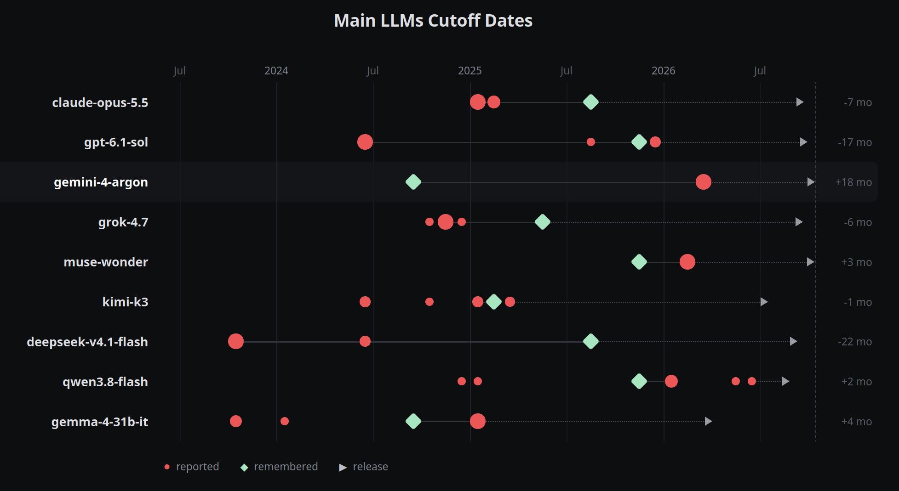

# cutoff-bench

Asks LLMs (via OpenRouter, no tools, no system prompt) what their knowledge cutoff is, then which models are state of the art. Compares the cutoff they report with the newest model they actually remember.

Site: https://franciscocarloserra.github.io/cutoff-bench/

Run: `OPENROUTER_API_KEY=... python3 ask.py <question> [model_substring]` appends to `data/runs.jsonl`. `python3 serve.py` serves the page locally.
